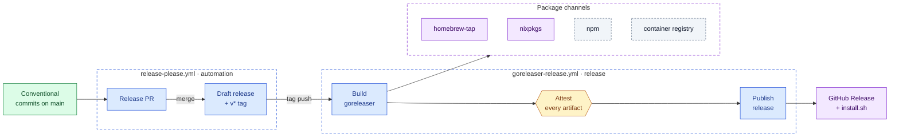
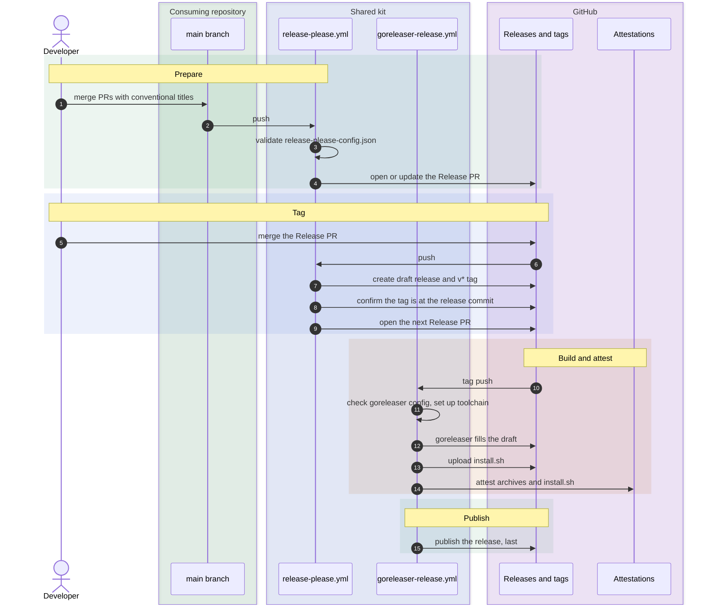
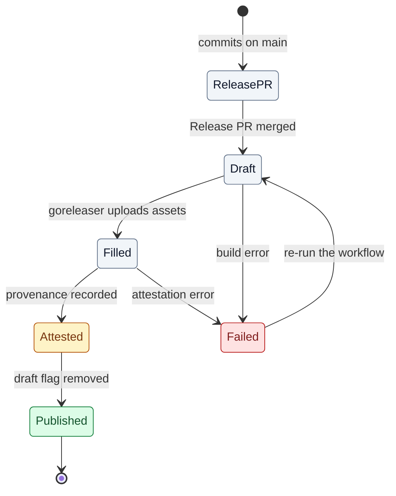
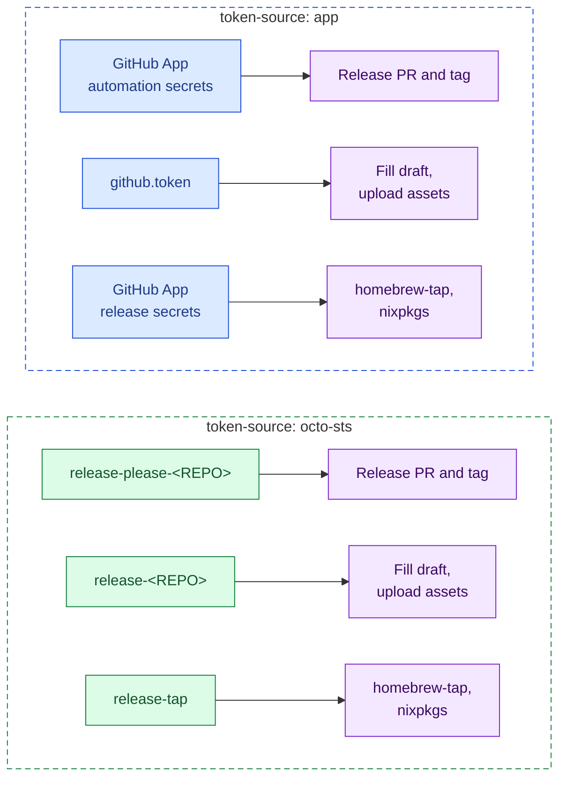
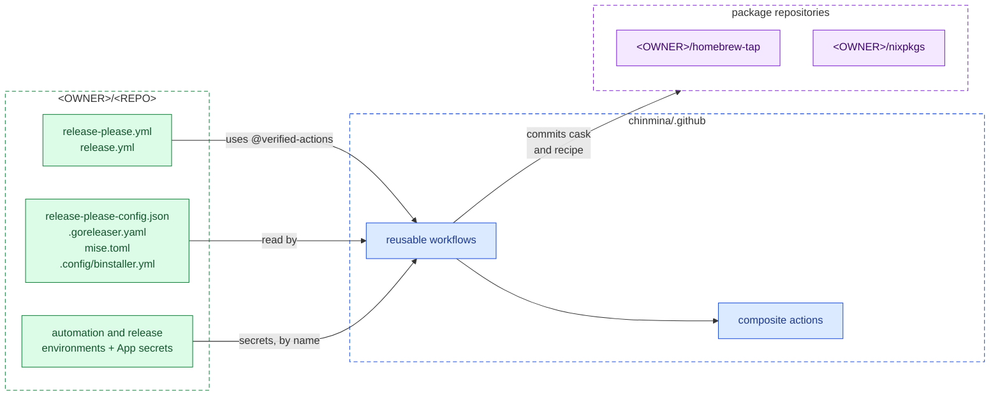

# Release pipeline overview

The shared release pipeline turns Conventional Commits on a repository's default branch into a published, attested release. A consuming repository adds two short caller workflows and its own release configuration. The build, attestation, and publishing logic lives in this repository.

This page explains how the pipeline works. To connect a repository, follow [Adopting the release pipeline](adopting-the-release-pipeline.md).

## Guarantees

- **Nothing is downloadable before its provenance exists.** The release stays a draft until every artifact has a build provenance attestation.
- **No long-lived signing key.** Attestations use Sigstore keyless signing, bound to the workflow run that built the artifacts.
- **Short-lived, scoped tokens.** Every write uses an installation token minted for the run, limited to the repositories that step writes to.
- **One configuration for every repository.** Callers differ only in their token source and the channels they disable.

## End to end

A release passes through two workflows. `release-please.yml` decides the version and creates the draft release. `goreleaser-release.yml` fills that draft, attests it, and publishes it.

Grey dashed channels are the ones a typical CLI tool disables. The Homebrew cask and Nix recipe are committed during the build, but their URLs point at release assets that return 404 until the release is published.

## Release sequence

The sequence below follows one release from commit to publication. The tag push in step 6 is what connects the two workflows. It is made with an installation token, because a tag pushed with `GITHUB_TOKEN` does not trigger workflows.

## Release states

A release is visible only once it is published, and it is published only after attestation. A failed run anywhere before that leaves a draft that no one can download. Fix the cause and re-run the workflow: `release.replace_existing_artifacts: true` lets goreleaser replace the assets an earlier run uploaded, and `install.sh` is overwritten.

Two side effects reach outside the draft:

- goreleaser commits the Homebrew cask and Nix recipe before attestation. After a later failure, they point at a release that is not yet published, so installs fail until a re-run succeeds. The re-run commits them again.
- npm versions cannot be overwritten. If the npm step fails after publishing some packages, a re-run fails on those packages. Release a new patch version instead.

| State | Visible to users | Holds |
| ----- | ---------------- | ----- |
| `ReleasePR` | No | The proposed version and changelog |
| `Draft` | No | The release-please notes and the `v*` tag |
| `Filled` | No | Archives, `checksums.txt`, and `install.sh` |
| `Attested` | No | A build provenance attestation for every artifact |
| `Published` | Yes | Everything above; prerelease tags are marked as prereleases |

## Token sources

Each workflow needs installation tokens with write access. A repository chooses where they come from with the `token-source` input, and both callers must use the same value.

`app` is the chinmina standard. A release GitHub App is installed on the consuming repository and the package repositories, and its credentials are stored as secrets in the `automation` and `release` environments. `octo-sts` is the keyless alternative for owners that run [octo-sts](https://github.com/octo-sts/app): tokens are exchanged for the job's OIDC token, against trust policies the owner defines for each identity.

| | `app` | `octo-sts` |
| - | ----- | ---------- |
| Stored credential | App private key, in both environments | None |
| Per-repository setup | Two secrets in each environment; App installed on the repository | Owner trust policies for `release-please-<REPO>`, `release-<REPO>`, and `release-tap` |
| Caller `secrets:` | Both App secrets, by name | Omitted |

## Where configuration lives

Configuration is split across repositories. A consuming repository controls its build configuration, and the shared kit controls how it is built, attested, and published.

| Repository | Holds | Changed by |
| ---------- | ----- | ---------- |
| `<OWNER>/<REPO>` | Caller workflows, build configuration, environments | The project's maintainers |
| `chinmina/.github` | Reusable workflows and composite actions | Reviewed changes, then a fast-forward of `verified-actions` |
| `<OWNER>/homebrew-tap`, `<OWNER>/nixpkgs` | Casks and recipes | The release job only |

## Channels

Every channel is on by default. A caller disables the channels its project does not ship.

| Channel | Publishes | Turn off with | Needs |
| ------- | --------- | ------------- | ----- |
| GitHub Release | Archives and `checksums.txt` | Always on | Nothing extra |
| binstaller | Attested `install.sh` | `disable-binstaller: true` | `binstaller` in `mise.toml`, `.config/binstaller.yml` |
| Homebrew | Cask in `<OWNER>/homebrew-tap` | `disable-homebrew: true` | `homebrew_casks:` in goreleaser, write access to the tap |
| Nix | Recipe in `<OWNER>/nixpkgs` | `disable-nix: true` | `nix:` in goreleaser, write access to `nixpkgs` |
| npm | One package per platform plus a launcher | `disable-npm: true` | See [Publishing to npm](publishing-to-npm.md) |
| Container image | Image built by goreleaser (ko or Docker) | `disable-docker-login: true` | See [Publishing container images](publishing-container-images.md) |

The [shed worked example](../reference/shed/) is a CLI tool that ships the first four channels.
