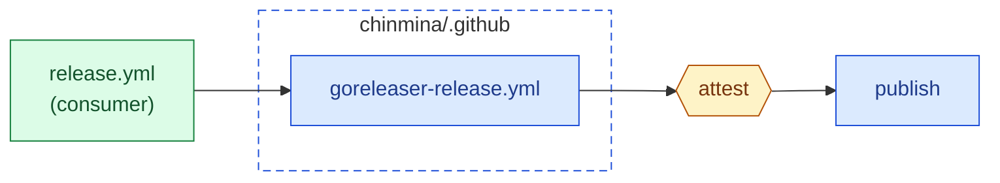
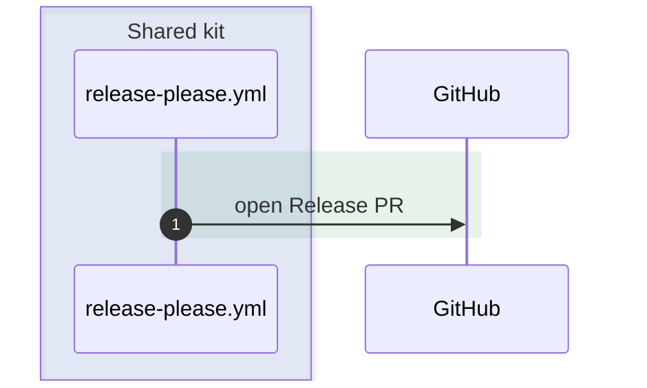
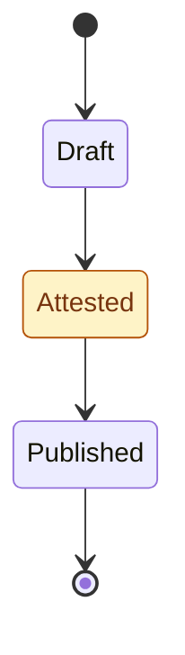

# GitHub Markdown Conventions

Implementation details for GitHub Flavored Markdown (GFM): page structure, alerts, code blocks, collapsible sections, tables, and Mermaid diagrams. Everything here renders on github.com and stays readable as raw text.

## Not Supported

Do not use the following. Most do not render on GitHub, and frontmatter renders as noise:

- MDX imports and JSX components (`<Steps>`, `<Aside>`, `<Badge>`, custom components)
- YAML frontmatter for titles or metadata. GitHub shows it as a table above the page; put the title in the `#` heading instead
- Directive syntax (`:::note`, `:::caution`)
- Code block attributes (`title="..."`, line highlighting such as `{3-5}` or `/pattern/`)
- D2 diagrams and Mermaid `%%{init: ...}%%` theme overrides

## Page Structure

Start each page with a single `#` heading in sentence case, followed by one or two sentences stating what the page covers. Use `##` for sections and `###` for subsections. Avoid going deeper than `####`, except for the H6 parameter pattern below.

**Title formatting:** Use sentence case (capitalise only the first word and proper nouns), not title case.

**Good:** `# Adopting the release pipeline`

**Bad:** `# Adopting The Release Pipeline`

## Alerts (Callouts)

Use GitHub alerts for notes, tips, and warnings. Use them sparingly: one or two per page section at most.

```markdown
> [!NOTE]
> The tag policy needs both `name=v*` and `type=tag`.

> [!TIP]
> Use a 'bot' user to create the token if you can, as this will not be affected
> when personnel in your organisation change.

> [!IMPORTANT]
> Create both environments before the first run.

> [!WARNING]
> An environment that does not exist is created on first use, with no protection rules.

> [!CAUTION]
> Deleting the tag after the release is published breaks provenance verification.
```

| Alert          | Use for                                                     |
| -------------- | ----------------------------------------------------------- |
| `[!NOTE]`      | Context the reader needs but can skim                       |
| `[!TIP]`       | A better way to do something                                |
| `[!IMPORTANT]` | Information required for success                            |
| `[!WARNING]`   | A mistake that causes a failure the reader must then debug  |
| `[!CAUTION]`   | An action with risky or irreversible consequences           |

## Code Blocks

Always set a language identifier: `sh`, `yaml`, `json`, `toml`, `nix`, `ruby`, `markdown`, or `text`.

Code blocks cannot carry a title. Name the file in the sentence before the block, as inline code, and repeat the path in a first-line comment when the format allows it:

````markdown
Create `.github/workflows/release.yml`:

```yaml
# .github/workflows/release.yml
name: release
```
````

Keep comments inside snippets short and factual. Explain the reason for a non-obvious line in a comment beside it; explain anything longer in the prose around the block.

To show a code block inside a code block, wrap the outer block in four backticks.

## Collapsible Sections

Use `<details>` for optional or alternative content, such as per-channel install instructions. Leave a blank line after `<summary>` so Markdown inside renders:

````markdown
<details>
<summary><strong>Homebrew (macOS)</strong></summary>

```sh
brew install <OWNER>/tap/<TOOL>
```

</details>
````

Never hide required steps in a collapsed section.

## Tables

Use tables for inputs, options, and comparisons with three or more parallel attributes. Keep cell content short; link to a section for anything longer. Use inline code for every identifier in a cell.

## Parameter Documentation

Use H6 headings with parameter names in backticks, followed by type and default value (if applicable) in italics:

```markdown
###### `disable-homebrew`

_(boolean, default: `false`)_

Skips Homebrew publication.
```

Use a table instead when a component has many parameters with one-line descriptions.

## Mermaid Diagrams

GitHub renders fenced `mermaid` blocks. Use them for flows, sequences, and lifecycles that are hard to follow in prose. Every diagram needs a sentence before it saying what it shows.

### Styling for light and dark mode

GitHub renders diagrams on the page background, which may be light or dark. Diagrams must read well in both:

- Give styled nodes a solid light fill, a darker stroke of the same hue, and an explicit dark text `color`.
- Give subgraphs `fill:none` with a coloured stroke, so their labels use the theme's text colour.
- Use semi-transparent `rgba()` fills for sequence diagram `rect` and `box` backgrounds.
- Do not set a theme with `%%{init: ...}%%`. It overrides the reader's theme.

Use this palette consistently, so a colour means the same thing on every diagram in the repository:

| Role                         | `classDef`                                                         |
| ---------------------------- | ------------------------------------------------------------------ |
| Shared kit (this repository) | `fill:#dbeafe,stroke:#1d4ed8,color:#1e3a8a`                        |
| Consumer repository          | `fill:#dcfce7,stroke:#15803d,color:#14532d`                        |
| External service or registry | `fill:#f3e8ff,stroke:#7e22ce,color:#3b0764`                        |
| Gate or check                | `fill:#fef3c7,stroke:#b45309,color:#78350f`                        |
| Failure or blocked state     | `fill:#fee2e2,stroke:#b91c1c,color:#7f1d1d`                        |
| Optional step                | `fill:#f1f5f9,stroke:#64748b,color:#0f172a,stroke-dasharray:4 3`   |

### Flowchart

````markdown

````

### Sequence diagram

Group participants with `box` and mark phases with `rect`. Use `autonumber` when the text refers to individual messages.

````markdown

````

### State diagram

Use `stateDiagram-v2` for lifecycles. Apply the palette with `classDef` and `class`:

````markdown

````

### Diagram rules

- Keep each diagram to one idea and about 15 nodes or fewer. Split larger diagrams.
- Use `<br/>` for line breaks in labels, and quote any label containing punctuation.
- Use the same names in the diagram as in the text and the code.
- Describe in prose anything a reader must act on. A diagram supports the text and never replaces it.

## Specific Patterns to Emulate

### Stub Acknowledgment

When content is incomplete, state it plainly:

```markdown
## Observability

This section is a stub. For now, refer to the `.envrc` file for details on the
environment variables that configure observability features.
```

### Footnotes for Tangential Information

Use standard Markdown footnotes:

```markdown
Controls are required to ensure that repository access is appropriately
limited.[^1]

[^1]: Changing this behaviour is a short-term goal.
```

### Honest About Limitations

Include dedicated sections for drawbacks and limitations. Don't minimise or hide them.

```markdown
## Limitations

goreleaser cannot yet emit the `postflight_steps` cask stanza directly, so the
cask carries it in `custom_block`.
```
